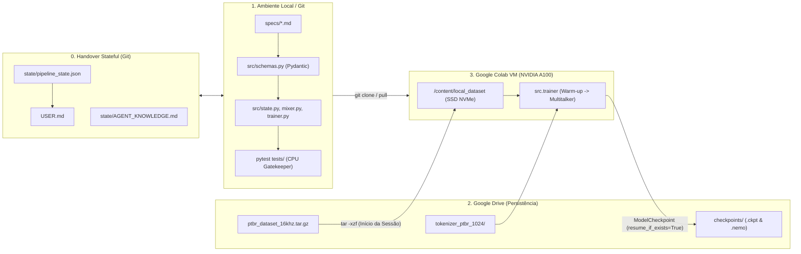

# Spec 00: Visão Geral da Arquitetura (Modelo + SDD no Google Colab)

## 1. Contexto do Modelo Base

O modelo **`nvidia/multitalker-parakeet-streaming-0.6b-v1`** é uma arquitetura de Reconhecimento Automático de Fala (ASR) de 600 milhões de parâmetros derivada do `nemotron-speech-streaming-en-0.6b`, projetada para resolver o *cocktail party problem* (fala sobreposta de múltiplos locutores) em tempo real (*streaming*).

### Componentes Internos Principais
1. **Diarização Online Parcerizada (Streaming Sortformer):**
   - Opera antes ou em paralelo ao ASR, identificando a atividade de voz por locutor a cada quadro de **80 ms** e gerando dois vetores temporais:
     - `spk_targets`: máscara de atividade do locutor-alvo em cada frame.
     - `bg_spk_targets`: máscara agregada de atividade dos locutores de fundo concorrentes.
2. **Execução Multi-Instância Sem Cadastro de Voz (*Enrollment-Free*):**
   - Para $N$ locutores simultâneos (tipicamente até 4), o sistema executa $N$ instâncias em lote sob o mesmo áudio misturado, mudando apenas quem recebe `spk_targets` como alvo.
3. **Injeção de Kernel do Locutor (*Speaker Kernel Injection*):**
   - Na camada 0 do codificador **FastConformer**, os estados acústicos $x$ são modulados pelas máscaras de diarização:
     $$x = x + \text{FF}(x \cdot \text{spk\_mask}) + \text{FF}_{\text{bg}}(x \cdot \text{bg\_mask})$$
   - Esse mecanismo é **agnóstico ao idioma**: separa quem está falando pelas características acústicas/espaciais da voz, permitindo preservar os pesos dos *Speaker Kernels* durante a adaptação para o Português Brasileiro (PT-BR).
4. **Streaming Baseado em Cache (*Cache-Aware Streaming*):**
   - O codificador mantém um cache de ativações passadas (contexto esquerdo de 70 frames) e opera com janelas direitas configuráveis (`[70, 0]`, `[70, 1]`, `[70, 6]`, `[70, 13]`), cobrindo latências entre **80 ms** e **1,12 s**.
5. **Decodificador RNN-T + Joint Network:**
   - Emite texto com pontuação e capitalização nativas diretamente no fluxo de streaming.

---

## 2. Arquitetura Spec-Driven Development (SDD) + Estado Persistente para Agentes

Este repositório é operado **exclusivamente por agentes de IA** ao longo de múltiplas sessões sem contexto compartilhado em memória. Para eliminar a perda de contexto entre agentes, evitar perda de estado quando a sessão do Google Colab cai e eliminar o gargalo de I/O de rede do Google Drive, o sistema é dividido em 4 camadas:

| Camada | Ambiente | Responsabilidade |
|---|---|---|
| **1. Fonte da Verdade (Specs + Código + Testes em Memória)** | Máquina Local + GitHub (`< 0.3 GB`) | Contém `specs/*.md`, contratos `src/schemas.py`, módulos `src/*.py` e testes `tests/*.py` validados em CPU com sinais sintéticos em memória (**zero download de datasets no Mac local**). |
| **2. Estado e Memória de Agentes (Handover)** | Git + Espelho Drive (`state/` + `USER.md`) | `state/pipeline_state.json` (máquina de estados), `state/AGENT_KNOWLEDGE.md` (conhecimento incremental) e `USER.md` (painel enxuto para o humano). |
| **3. Armazenamento Persistente de Artefatos** | Google Drive (`/content/drive/MyDrive/parakeet_ptbr`) | Armazena pacotes compactados de áudio (`.tar.gz`), manifestos `.json`, artefatos do tokenizador BPE, espelho do `state/` e checkpoints `.ckpt`/`.nemo`. |
| **4. Computação Efêmera (Worker Dados + GPU)** | Google Colab (CPU High-RAM p/ Steps 01–04; GPU A100 p/ Steps 05–07) | Executa `colab_runner.ipynb`: valida contratos com `pytest`, gera/descompacta o `.tar.gz` no SSD NVMe local (`/content/local_dataset`) via `src.data_prep --ensure_colab_dataset` e executa `python -m src.trainer`. |

